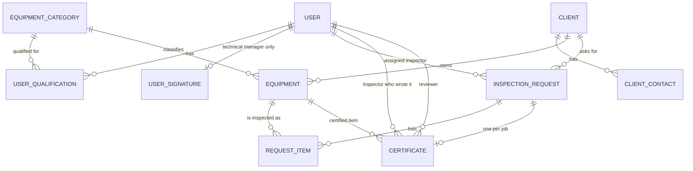

# EF Core data model: backend user stories (Users, Clients, Equipment, Certificates)

Audience: the .NET backend developer.
Source: the current Firestore models in the Flutter app (`users`, `clients`, `requests`, `certificates`) and `firestore.rules`.
Related: [login-flow-user-stories.md](login-flow-user-stories.md) (auth, roles) and [CertificateDocumentBuilder.cs](CertificateDocumentBuilder.cs) (PDF).

Target: EF Core 8 or newer, relational database (PostgreSQL or SQL Server, not decided yet, see Open questions). The code below is a design sketch, not compiled.

---

## 1. What changes when moving from Firestore to relational

| Firestore today | EF Core design |
|---|---|
| `clients/{id}` with embedded `contacts[]` and `equipment[]` | `Client` has many `ClientContact`; `Equipment` is its own table owned by a client |
| `users/{uid}` with embedded `qualifications[]` | `User` has many `UserQualification`, each pointing at an `EquipmentCategory` |
| `certificates/{requestId}` with `texts`, `dates`, `answers` maps keyed by template keys | One `Certificate` row with typed columns for the fixed TÜV template |
| Equipment typed twice: `ClientEquipmentItem` (register) and `RequestItem` (on a request) | One `Equipment` asset; a request item points at it (`EquipmentId`) |
| `requests` reference clients by `clientId` string, no integrity | Real foreign keys |
| String ids (`uid`, doc ids like `dummy-task-01`) | `Guid` primary keys plus a `LegacyId` column for migrated rows |
| Server timestamps, security rules enforce who writes what | `DateTimeOffset` in UTC set by the server, rules move into the application layer (see login stories, BE-AUTH-07) |

### Entity relationship diagram



`InspectionRequest` and `RequestItem` belong to the jobs module (a separate epic). They are shown because certificates and equipment hang off them.

---

## 2. Epic: Persistence foundation

### BE-DATA-01: Shared conventions and DbContext
**As** a backend developer,
**I want** one set of conventions applied to every table,
**so that** the model stays consistent and easy to review.

Acceptance criteria
- One `InspectaDbContext`. Each entity has its own `IEntityTypeConfiguration<T>` class, loaded with `ApplyConfigurationsFromAssembly`.
- Primary keys are `Guid` (sequential, for example `Guid.CreateVersion7()` or the provider's sequential generator).
- Base class `AuditableEntity` adds `CreatedAt`, `CreatedBy`, `UpdatedAt`, `UpdatedBy`. A `SaveChanges` interceptor fills them from the clock and the current user. Time is `DateTimeOffset` in UTC.
- Date-only fields (examination date, due date, qualification expiry) use `DateOnly`, not a timestamp.
- Enums are stored as strings (`HasConversion<string>()`), not integers, so the data stays readable and safe to reorder.
- Money is never needed in these four modules. If it appears later, use `decimal(18,2)` or integer piastres as the timesheet module does today.
- `RowVersion` (`IsRowVersion()`) on `Client`, `Equipment` and `Certificate` for optimistic concurrency. A conflict returns `409`.
- Soft delete via `IsArchived` plus a global query filter on `Client` and `Equipment`. Users are deactivated (`Active = false`), never deleted. Certificates are never deleted (today's rule: `delete: false`).
- Naming: snake_case or PascalCase, one convention for the whole database (agree with the DBA).
- Migrations live in one project. A CI check fails if the model and the latest migration differ.

```csharp
public abstract class AuditableEntity
{
    public Guid Id { get; set; }
    public DateTimeOffset CreatedAt { get; set; }
    public Guid? CreatedBy { get; set; }
    public DateTimeOffset UpdatedAt { get; set; }
    public Guid? UpdatedBy { get; set; }
}
```

---

## 3. Epic: Users module

### BE-DATA-02: Store users, roles and qualifications
**As** the platform,
**I want** staff accounts with exactly one role and their equipment qualifications,
**so that** login, assignment and authorization have a reliable source (BR-01.1, BR-01.4).

Acceptance criteria
- `User` extends `IdentityUser<Guid>` (ASP.NET Core Identity) to get password hashing and lockout. Custom columns:

| Column | Type | Notes |
|---|---|---|
| `Name` | string(120), required | |
| `Email` | string(254), required | unique index on the normalized value (Identity's `NormalizedEmail`) |
| `PhoneNumber` | string(32), null | |
| `Role` | enum string, required | `Coordinator`, `Inspector`, `TechnicalManager`, `Admin`. One role per user. Legacy `supervisor` is imported as `Coordinator`. |
| `Active` | bool, required, default false | a missing value means not activated |
| `LastLoginAt` | DateTimeOffset, null | |
| `OnLeaveUntil` | DateOnly, null | inspectors only |
| `LegacyFirebaseUid` | string(128), null, unique | for migration and for mapping old `createdBy` and `actorId` values |

- Identity's many-to-many role tables are not used, because a user has one role. Authorization uses the `Role` column as a claim and policies.
- `UserQualification`: `Id`, `UserId`, `EquipmentCategoryId`, `ValidUntil` (DateOnly, null = never expires). Unique index on (`UserId`, `EquipmentCategoryId`). Cascade delete from `User`.
- `UserSignature`: `UserId` (PK and FK, one per technical manager), `Strokes` (JSON), `UpdatedAt`. Strokes are a list of flat `[x0, y0, x1, y1, ...]` lists normalized to 0..1, at most 100 strokes. Stored as a JSON column (`jsonb` on PostgreSQL, `nvarchar(max)` with a JSON value converter on SQL Server).
- Check constraint: only users with role `TechnicalManager` may have a `UserSignature` (enforced in the application, and a trigger or check if the provider allows it).
- Check constraint: `OnLeaveUntil` only for role `Inspector`.
- Computed in queries, not stored: "is on leave" (`OnLeaveUntil > today`), "qualification expiring soon", "qualification expired".
- Index on (`Role`, `Active`) for the assign-inspector list.
- A user's password hash and security stamp never appear in any DTO.

```csharp
public class User : IdentityUser<Guid>
{
    public string Name { get; set; } = "";
    public UserRole Role { get; set; }
    public bool Active { get; set; }
    public DateTimeOffset? LastLoginAt { get; set; }
    public DateOnly? OnLeaveUntil { get; set; }
    public string? LegacyFirebaseUid { get; set; }
    public List<UserQualification> Qualifications { get; set; } = [];
    public UserSignature? Signature { get; set; }
}

public class UserQualification
{
    public Guid Id { get; set; }
    public Guid UserId { get; set; }
    public Guid EquipmentCategoryId { get; set; }
    public DateOnly? ValidUntil { get; set; }
}
```

### BE-DATA-03: Equipment categories as reference data
**As** a coordinator,
**I want** a fixed list of equipment categories (for example Lifts, Cranes, Pressure vessels),
**so that** inspector qualifications and equipment records use the same names and matching works.

Acceptance criteria
- `EquipmentCategory`: `Id`, `Code` (unique, stable), `NameEn`, `NameAr`, `IsActive`, `SortOrder`.
- Seeded through migrations (`HasData`), editable only by an admin.
- Qualifications and equipment point to it by foreign key. Deleting a category that is in use is refused (`Restrict`); retire it with `IsActive = false`.
- Existing free-text qualification names and equipment categories are mapped to categories during migration. Unmapped values are listed in a report, not silently dropped.

---

## 4. Epic: Clients module

### BE-DATA-04: Store clients and their contacts
**As** a coordinator,
**I want** client companies with their contacts and the email where certificates are sent,
**so that** requests, quotations and certificates reach the right people.

Acceptance criteria
- `Client`:

| Column | Type | Notes |
|---|---|---|
| `CompanyName` | string(200), required | unique index on (`CompanyName`, `Location`) among non-archived rows |
| `Location` | string(300), required | |
| `CertificatesEmail` | string(254), null | shared inbox for issued certificates |
| `TaxNumber` | string(50), null | empty string imported as null |
| `Latitude`, `Longitude` | double, null | both set or both null (check constraint); ranges -90..90 and -180..180 |
| `IsArchived` | bool | soft delete |
| audit columns, `RowVersion` | | |

- `ClientContact`: `Id`, `ClientId` (cascade), `Name` (required), `Role`, `Email`, `Phone`, `IsMain`.
  - A client has at most one main contact: unique filtered index on (`ClientId`) where `IsMain = 1`.
  - Index on `Email`, used to match the sender of an incoming request email to a client.
  - The "main contact" used for display is the one with `IsMain`, otherwise the first by creation date.
- A client's equipment count and "due soon" count are queries over `Equipment`, not stored columns.
- Archiving a client hides it from lists but keeps its requests, quotations, equipment and certificates intact.

```csharp
public class Client : AuditableEntity
{
    public string CompanyName { get; set; } = "";
    public string Location { get; set; } = "";
    public string? CertificatesEmail { get; set; }
    public string? TaxNumber { get; set; }
    public double? Latitude { get; set; }
    public double? Longitude { get; set; }
    public bool IsArchived { get; set; }
    public byte[] RowVersion { get; set; } = [];
    public List<ClientContact> Contacts { get; set; } = [];
    public List<Equipment> Equipment { get; set; } = [];
}
```

---

## 5. Epic: Equipment module

### BE-DATA-05: One equipment register per client
**As** a coordinator,
**I want** each piece of client equipment recorded once and reused on every request and certificate,
**so that** repeat inspections, due dates and history all line up.

Today the same thing is stored twice: `ClientEquipmentItem` (type, serial, location, last result, next due date) on the client, and `RequestItem` (adds category, manufacturer, model, PR number, capacity, quantity) on each request. This story merges the asset side into one table.

Acceptance criteria
- `Equipment`:

| Column | Type | Notes |
|---|---|---|
| `ClientId` | FK, required | `Restrict` on delete |
| `CategoryId` | FK to `EquipmentCategory`, required | |
| `Type` | string(120), required | free text, for example "Overhead crane" |
| `Manufacturer`, `Model` | string(120), null | |
| `YearOfManufacture` | short, null | |
| `SerialNumber` | string(120), null | unique filtered index on (`ClientId`, `SerialNumber`) where not null |
| `PrNumber` | string(60), null | the client's purchase-requisition or asset reference |
| `Capacity` | string(60), null | for example "20 t"; stays text for now |
| `Location` | string(300), null | site or area within the client |
| `OwnerReference` | string(120), null | printed as "Owner ID" on the certificate |
| `HasAngle` | bool, required | set by the admin when the equipment is created, see BE-DATA-05a |
| `Status` | enum string | `Active`, `Retired` |
| `CertificateExpiryDate` | DateOnly, required for new rows (null only for legacy imports) | the expiry of the equipment's certificate. Set by the admin at creation, then moved forward when a new certificate is approved. Index, drives the "due soon" list. Replaces the old `NextDueDate`. |
| `LastInspectedOn` | DateOnly, null | maintained, see below |
| `LastInspectionResult` | enum string, null | same values as the certificate's final result |
| audit columns, `RowVersion`, `IsArchived` | | |

- `LastInspectedOn` and `LastInspectionResult` are a cache. They are updated in the same transaction that approves a certificate (BE-DATA-07), never edited by hand.
- `CertificateExpiryDate` is entered by an admin at creation. After that, approving a new certificate for the item sets it to that certificate's `NextExaminationDate`. An admin can still correct it by hand (audit-logged).
- "Due soon" is expiring within 30 days and not already expired, as the app computes it today. Expired is a separate query.
- A request item (`RequestItem`) keeps its own snapshot fields (type, manufacturer, model, serial, capacity, location, quantity) and has a nullable `EquipmentId`. It is null until the coordinator matches it to a register entry. Matching is optional and never blocks a request.
- A quantity above 1 on a request item means several identical units. They become separate `Equipment` rows when matched, one certificate each (see Open questions).
- Equipment can move between clients only through an explicit admin action that is audit-logged. Normal edits cannot change `ClientId`.
- Index on (`ClientId`, `CategoryId`) for the client's equipment list.

```csharp
public class Equipment : AuditableEntity
{
    public Guid ClientId { get; set; }
    public Guid CategoryId { get; set; }
    public string Type { get; set; } = "";
    public string? Manufacturer { get; set; }
    public string? Model { get; set; }
    public short? YearOfManufacture { get; set; }
    public string? SerialNumber { get; set; }
    public string? PrNumber { get; set; }
    public string? Capacity { get; set; }
    public string? Location { get; set; }
    public string? OwnerReference { get; set; }
    public bool HasAngle { get; set; }
    public EquipmentStatus Status { get; set; }
    public DateOnly? CertificateExpiryDate { get; set; }   // required by the API on create
    public DateOnly? LastInspectedOn { get; set; }
    public CertificateResult? LastInspectionResult { get; set; }
    public bool IsArchived { get; set; }
    public byte[] RowVersion { get; set; } = [];
}
```

### BE-DATA-05a: Admin registers equipment with an expiry date and an angle flag
**As** an admin,
**I want** to set the certificate expiry date and say whether the equipment has an angle when I create it,
**so that** expiry tracking starts from day one and inspectors see the right details for the item.

`POST /equipment` (role: `admin`)

Acceptance criteria
- Only an `admin` can create equipment. Other roles can read it, and coordinators can match request items to it (BE-DATA-05).
- Required on create:
  - `clientId`, `categoryId`, `type`.
  - `certificateExpiryDate`: a date. It must not be in the past (a past date returns `400 expiry_in_past`). An admin who is registering already-expired equipment must use an explicit flag `allowExpired = true`, so it is deliberate.
  - `hasAngle`: `true` or `false`. It has no default, so the admin must choose. Missing returns `400 has_angle_required`.
- Optional on create: manufacturer, model, year, serial number, PR number, capacity, location, owner reference.
- `HasAngle` is a property of the equipment, not of a job. It decides whether the certificate asks for an angle reading (BE-DATA-06). Changing it later is allowed for admins only and is audit-logged, because it changes what an inspector has to record. It only affects certificates created after the change.
- Creating equipment sets `Status = Active`, leaves `LastInspectedOn` and `LastInspectionResult` empty, and writes an audit entry (who, when).
- A duplicate serial number for the same client returns `409 duplicate_serial`.
- Validation messages return stable codes, like the login errors, so the app can translate them to English and Arabic.
- The admin can edit `certificateExpiryDate` and `hasAngle` afterwards (`PATCH /equipment/{id}`). Each change records the old and new value.

---

## 6. Epic: Certificates module

### BE-DATA-06: Store the TÜV "Report of Thorough Examination"
**As** an inspector,
**I want** my certificate draft saved as I fill it in,
**so that** I can stop and resume, and the technical manager reviews exactly what I submitted.

One certificate per job, written by the assigned inspector, edited while the job is `in_progress` or `certificate_returned`, locked otherwise. The template is fixed (`TUV-RTE-01`), so the fields become typed columns. This matches the PDF DTO in `CertificateDocumentBuilder.cs`.

Acceptance criteria
- `Certificate` columns, grouped:

| Group | Columns |
|---|---|
| Identity and links | `RequestId` (FK, **unique**), `EquipmentId` (FK, null), `InspectorId` (FK to `User`), `TemplateId` (string, default `TUV-RTE-01`) |
| Details block | `ClientRepresentative`, `StandardOfInspection`, `TestType` (default "Visual & function test"), `ExaminationDate` (DateOnly), `NextExaminationDate` (DateOnly) |
| Item block (snapshot) | `Manufacturer`, `ModelYear`, `MaxWorkingRate`, `SerialNumber`, `OwnerId`, `Ndt`, `FunctionCheck` (enum `Unanswered`, `Pass`, `Fail`, `Na`) |
| Angle (only for equipment with an angle) | `HasAngle` (bool, copied from the equipment when the certificate is created), `AngleReadingDegrees` (decimal(5,2), null) |
| Yes/no questions | `FirstExamination`, `InstalledCorrectly`, `Within6Months`, `Within12Months`, `ExaminationScheme`, `ExceptionalCircumstances`, `ExistingDanger`, `FutureDanger` (all `bool?`, null = unanswered), `FutureDangerBy` (DateOnly, null) |
| Findings | `DefectDescription`, `RepairsRequired`, `TestsCarriedOut`, `Note` (all text, null) |
| Verdict | `FinalResult` (enum `SafeToOperate`, `SafeWithConditions`, `NotSafe`, null) |
| Author snapshot | `PreparedByName`, `PreparedByQualifications` (copied from the inspector's profile at submit, so later profile changes don't rewrite old certificates) |
| Submission | `SubmittedAt` (set by the server only, never by the autosave) |
| Review | `ReviewerId` (FK, null), `ReviewerName`, `ReviewerLicense`, `ReviewerComments`, `ReviewNote` (the send-back reason), `ReviewedAt`, `SignatureStrokes` (JSON snapshot of the reviewer's drawing) |
| Issue | `CertificateNumber` (unique, null until approved), `VerificationCode` (unique, null until approved), `QrData`, `IssuedClientName`, `IssuedLocation`, `IssuedItem`, `SentTo`, `SentAt` |
| Concurrency and audit | `RowVersion`, audit columns |

- Business rules the application enforces (not left to the client):
  - Autosave writes only the inspector's draft fields. It never touches submission, review or issue columns.
  - Edits are allowed only while the request status is `in_progress` or `certificate_returned`, and only by the assigned inspector.
  - `HasAngle` is copied from `Equipment.HasAngle` when the certificate is created, and the inspector cannot change it. It is a snapshot, so a later change to the equipment doesn't rewrite certificates already written. If the job has no linked equipment (`EquipmentId` is null), `HasAngle` is false and the angle field is not shown; the coordinator should match the equipment first.
  - When `HasAngle` is true, `AngleReadingDegrees` is required to submit. It is a number in degrees, from 0 to 360 inclusive, with up to 2 decimals (range to be confirmed). When `HasAngle` is false the API rejects any angle value (`400 angle_not_applicable`), so the two never disagree.
  - `InstalledCorrectly` only counts when `FirstExamination` is true.
  - `Within6Months` and `Within12Months` are always opposites. Setting one sets the other.
  - Ready to submit means: examination date, next examination date, standard of inspection, test type, function check answered, the angle reading entered (only when `HasAngle` is true), all yes/no questions answered (installed-correctly only for a first examination), and a final result chosen. Findings text is never required.
  - Suggested next examination date: examination date plus 6 months, minus one day (24/09/2026 gives 23/03/2027). The server may suggest it, the inspector may change it.
- Resubmitting after a return clears the reviewer fields (comments, name, license, signature) and sets a new `SubmittedAt`. The previous return reason is kept in the request's event log, which is append-only.
- Certificates are never deleted.
- Indexes: unique (`RequestId`), unique filtered (`CertificateNumber`), unique filtered (`VerificationCode`), (`InspectorId`, `SubmittedAt`) for the inspector's list and profile counts, (`SubmittedAt`) for the technical manager's review queue.

```csharp
public class Certificate : AuditableEntity
{
    public Guid RequestId { get; set; }
    public Guid? EquipmentId { get; set; }
    public Guid InspectorId { get; set; }
    public string TemplateId { get; set; } = "TUV-RTE-01";

    public string? ClientRepresentative { get; set; }
    public string? StandardOfInspection { get; set; }
    public string TestType { get; set; } = "Visual & function test";
    public DateOnly? ExaminationDate { get; set; }
    public DateOnly? NextExaminationDate { get; set; }

    public string? Manufacturer { get; set; }
    public string? ModelYear { get; set; }
    public string? MaxWorkingRate { get; set; }
    public string? SerialNumber { get; set; }
    public string? OwnerId { get; set; }
    public string? Ndt { get; set; }
    public ChecklistAnswer FunctionCheck { get; set; } = ChecklistAnswer.Unanswered;

    public bool HasAngle { get; set; }
    public decimal? AngleReadingDegrees { get; set; }   // decimal(5,2); required to submit when HasAngle

    public bool? FirstExamination { get; set; }
    public bool? InstalledCorrectly { get; set; }
    public bool? Within6Months { get; set; }
    public bool? Within12Months { get; set; }
    public bool? ExaminationScheme { get; set; }
    public bool? ExceptionalCircumstances { get; set; }
    public bool? ExistingDanger { get; set; }
    public bool? FutureDanger { get; set; }
    public DateOnly? FutureDangerBy { get; set; }

    public string? DefectDescription { get; set; }
    public string? RepairsRequired { get; set; }
    public string? TestsCarriedOut { get; set; }
    public string? Note { get; set; }
    public CertificateResult? FinalResult { get; set; }

    public string? PreparedByName { get; set; }
    public string? PreparedByQualifications { get; set; }
    public DateTimeOffset? SubmittedAt { get; set; }

    public Guid? ReviewerId { get; set; }
    public string? ReviewerName { get; set; }
    public string? ReviewerLicense { get; set; }
    public string? ReviewerComments { get; set; }
    public string? ReviewNote { get; set; }
    public DateTimeOffset? ReviewedAt { get; set; }
    public List<List<double>> SignatureStrokes { get; set; } = [];   // JSON column

    public string? CertificateNumber { get; set; }
    public string? VerificationCode { get; set; }
    public string? QrData { get; set; }
    public string? IssuedClientName { get; set; }
    public string? IssuedLocation { get; set; }
    public string? IssuedItem { get; set; }
    public string? SentTo { get; set; }
    public DateTimeOffset? SentAt { get; set; }

    public byte[] RowVersion { get; set; } = [];
}
```

### BE-DATA-07: Issue a certificate on approval
**As** a technical manager,
**I want** approving a certificate to issue its number and QR code in one safe step,
**so that** every issued certificate is unique and verifiable.

Acceptance criteria
- Approval runs in one database transaction: sets reviewer fields and `ReviewedAt`, copies the signature from `UserSignature` into `SignatureStrokes`, assigns `CertificateNumber` and `VerificationCode`, builds `QrData`, fills `IssuedClientName`, `IssuedLocation`, `IssuedItem`, moves the request to `certificate_approved`, writes the request event, and updates the linked `Equipment` (`LastInspectedOn`, `LastInspectionResult`, and `CertificateExpiryDate` set from the certificate's `NextExaminationDate`).
- Certificate numbers come from a database sequence, formatted like `CERT-2026-6612`. They never repeat, and a failed approval may leave a gap but never a duplicate. Concurrent approvals must not collide (unique index is the final guard).
- `VerificationCode` is a cryptographically random value (at least 128 bits, base64url), not derived from ids.
- Only a technical manager may approve or return, only while the request is `certificate_submitted`. Returning writes `ReviewNote` and moves the request to `certificate_returned`, and issues nothing.
- Once issued, number, code, QR data and the snapshot fields never change.
- The coordinator may then record `SentTo` and `SentAt` and move the request to `sent_to_client`. Nothing else on the certificate changes at that step.

### BE-DATA-08: Public certificate verification
**As** a client who received a certificate,
**I want** to scan its QR code and see that it is genuine,
**so that** I can trust the document without logging in.

Acceptance criteria
- `GET /verify/{verificationCode}` is anonymous and returns only: certificate number, client name, location, item, result, examination date, next examination date, reviewer name, issue date. No inspector details, internal ids or findings text.
- Returns `404` for an unknown or not-yet-issued code. The response time is similar either way. The endpoint is rate limited per IP.
- Today the QR carries the job id in the path. Certificates already issued keep working: `QrData` is migrated unchanged, and a legacy route resolves the old identifier to the same certificate.
- New certificates use the random `VerificationCode` in the QR instead of the request id.

---

## 7. Epic: Migration

### BE-DATA-09: Import the Firestore data
**As** the product owner,
**I want** all existing data moved into the new database without losing history,
**so that** the switch is invisible to users.

Acceptance criteria
- A repeatable import tool (idempotent, safe to run twice, supports a dry run) reads Firestore and writes through EF Core. It logs a count per collection and every rejected row with the reason.
- Id mapping: each source document gets a new `Guid`, with the old id stored in `LegacyId` (or `LegacyFirebaseUid` for users). All references (`clientId`, `inspectorId`, `coordinatorId`, `createdBy`, `actorId`, `reviewedBy`) are rewritten through the map. References that can't be resolved are reported, not guessed.
- Users: `supervisor` becomes `Coordinator`; a missing `active` becomes false; qualifications (map or bare string) become `UserQualification` rows linked to a category.
- Clients: embedded `contacts[]` become `ClientContact` rows; an empty `taxNumber` becomes null; the first contact becomes main if none is flagged.
- Equipment: each `client.equipment[]` entry becomes an `Equipment` row. The old `nextDueDate` becomes `CertificateExpiryDate`; entries with no date are listed in the report so an admin can fill them in. `HasAngle` does not exist in Firestore, so every imported row needs an admin decision: import with a temporary "unset" state and list them, rather than guessing `false`. Request items are matched by client and serial number where possible, otherwise left unmatched (`EquipmentId` null).
- Certificates: existing certificates have no angle data, so they import with `HasAngle = false` and no reading. `texts`, `dates` and `answers` maps become the typed columns (unknown keys are reported); the `signature` list of `{p: [...]}` becomes `SignatureStrokes`; Firestore timestamps for date-only fields convert to `DateOnly` using the Africa/Cairo time zone; `templateId` of older certificates is kept so they can be flagged as pre-template.
- After import, a verification report compares counts and spot-checks a sample (for example 20 certificates field by field). Sign-off is required before cutover.
- Cutover steps and rollback are written down before the import runs on production data.

---

## 8. Out of scope here
- Jobs module tables (`InspectionRequest` details, `RequestItem`, request events, status history), quotations, timesheets and settings. Each needs its own data-model story.
- File storage for generated PDFs and signature images.
- Authentication tables (refresh tokens, reset tokens) and audit log: see the login stories.

## 9. Open questions
1. **Database provider**: PostgreSQL or SQL Server? It decides the JSON column type, filtered-index syntax and sequence handling.
2. **One certificate per job or per equipment unit?** Today it is one per job (`certificates/{requestId}`), but a request item can have quantity above 1 and several different items. The design above keeps one per job with a nullable `EquipmentId`. If each unit needs its own certificate, `RequestId` stops being unique and the key becomes (`RequestId`, `EquipmentId`).
3. **Keep Guid ids or keep the Firebase string ids?** Guid plus `LegacyId` is recommended. Keeping strings is simpler for the migration but gives up sequential keys.
4. **Capacity as text or number plus unit?** The certificate prints "20 t". Text is kept for now.
5. **Review history**: today only the latest review is on the certificate and returns are visible in the request event log. Is a separate `CertificateReview` history table wanted?
6. **Number format**: is `CERT-{year}-{sequence}` final, and does the sequence restart each year?
7. **Equipment categories**: who owns the master list, and are there more levels (category, then type)?
8. **Angle fields on the certificate**: I added one field, `AngleReadingDegrees`, required when the equipment has an angle. Is one reading enough, or are more needed (for example a minimum and maximum, an angle at rated load, a pass/fail on the angle, or a unit other than degrees)? What is the valid range?
9. **Expiry date vs next examination date**: I treat the admin's expiry date and the certificate's next examination date as the same thing (the expiry moves forward on each approval). If the two are separate (for example the legal expiry differs from the suggested re-inspection date), `Equipment` needs both columns.
10. **Who may create equipment**: only admins, as stated. Should coordinators be able to add equipment too, with the expiry and angle fields locked to admins?
